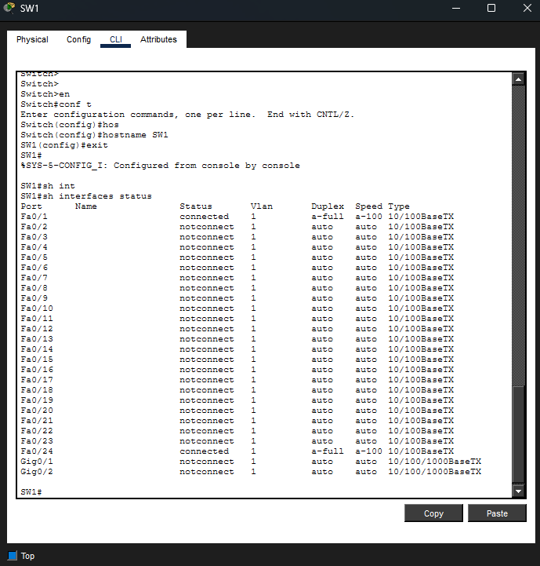
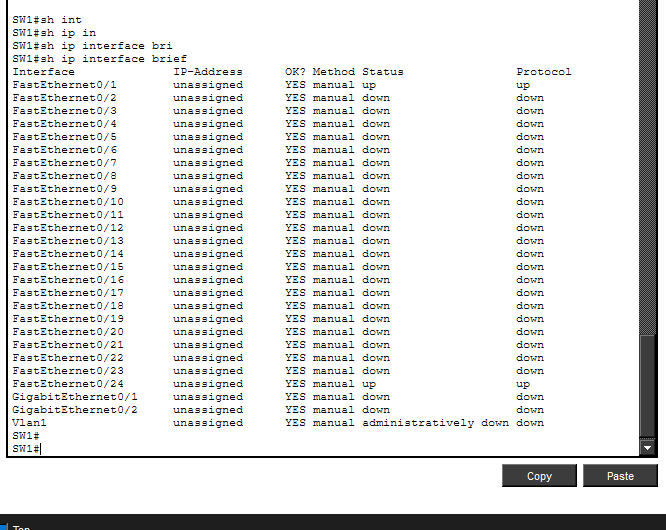
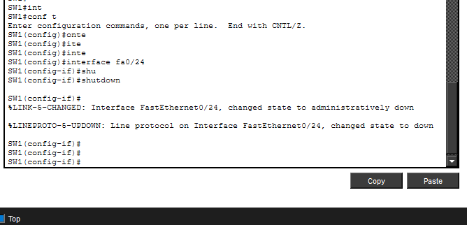
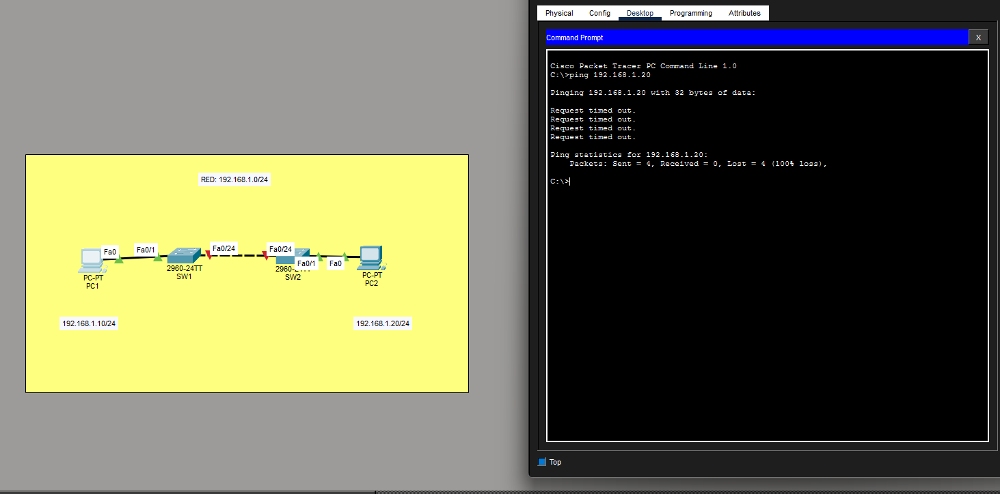
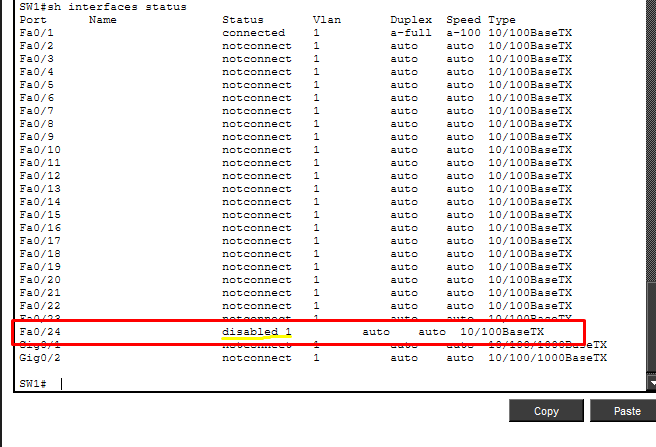
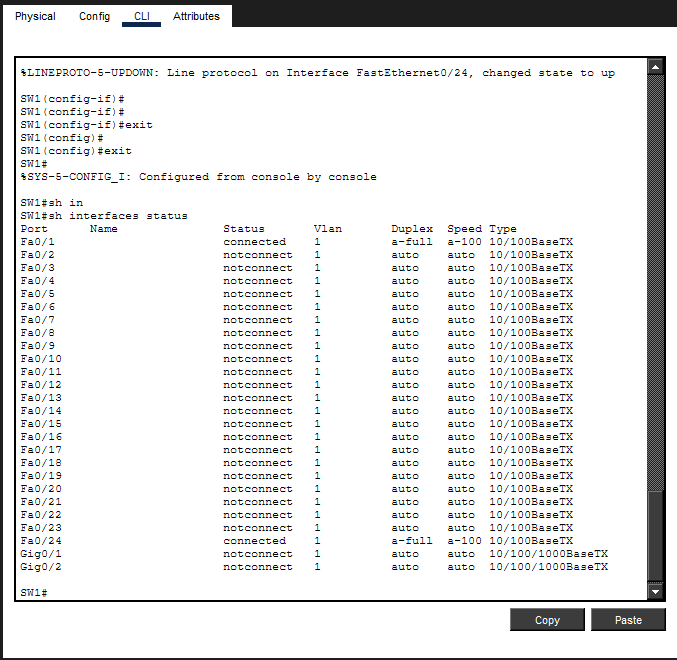

# Lab 02 — Network Troubleshooting Evidence

## 1. Network Topology

## 2. Initial Switch Configuration

## 3. Interface Status Verification

## 4. Interface Inspection

## 5. IP Interface Status

## 6. Baseline Verification

## 7. Connectivity Failure

## 8. Troubleshooting — First Inspection

## 9. Troubleshooting — Interface Status

## 10. Troubleshooting — Root Cause

## 11. Interface Recovery

