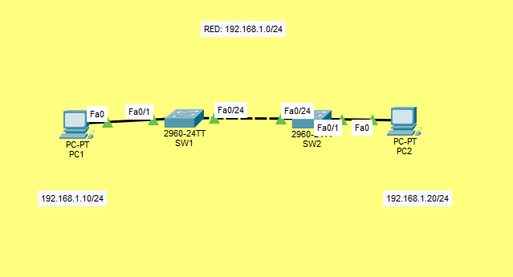
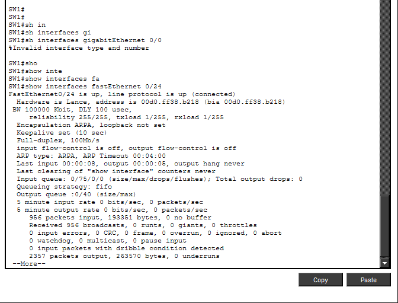
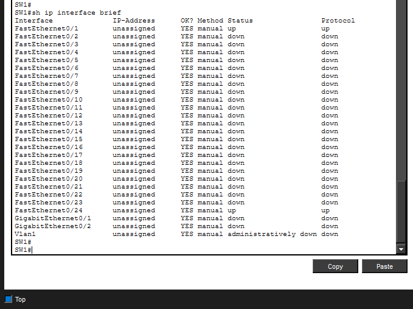
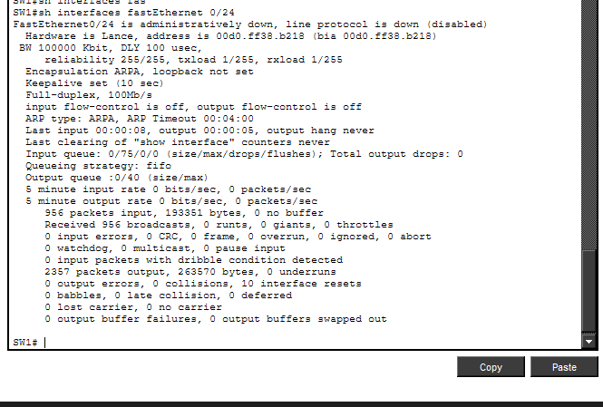
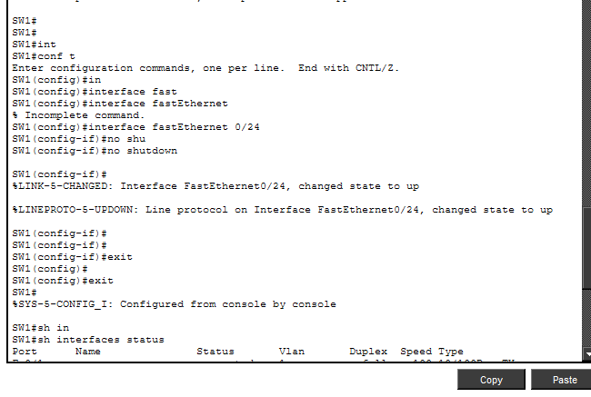
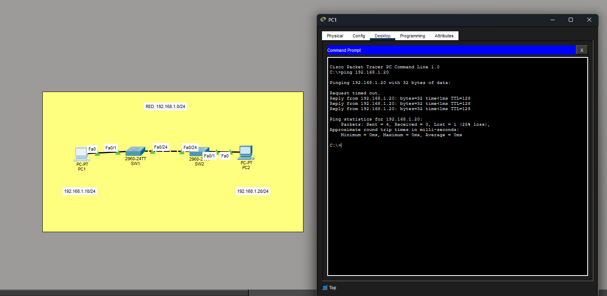

# Lab 02 — Ethernet Interfaces & Troubleshooting Evidence

**CCNA 200-301 | Cisco Packet Tracer**

This folder contains the technical evidence collected during Lab 02. The purpose of this lab was to build a working Ethernet LAN, deliberately simulate an interface failure, troubleshoot the issue using Cisco IOS commands, and restore network connectivity.

---

## 1. Network Topology



The network consists of two Cisco Catalyst 2960 switches and two PCs connected in the same IPv4 subnet (`192.168.1.0/24`).

**Network connections:**
- PC1 → SW1 FastEthernet0/1
- SW1 FastEthernet0/24 → SW2 FastEthernet0/24
- SW2 FastEthernet0/1 → PC2

The switch-to-switch connection uses a copper cross-over cable.

## 2. Initial Switch Configuration


The initial configuration and interface status were verified using Cisco IOS.

## 3. Switch Interface Status



The `show interfaces status` command was used to identify connected and disconnected interfaces.

## 4. Detailed Interface Verification


The `show interfaces fastEthernet 0/24` command was used to examine the operational state of the connection between SW1 and SW2.

## 5. IPv4 Interface Summary



The `show ip interface brief` command was used to inspect interface status and line protocol information.

## 6. Initial Network Verification


The switch interface information was reviewed before introducing the simulated network failure.

---

## 7. Simulated Connectivity Failure


The FastEthernet0/24 interface on SW1 was administratively disabled using the `shutdown` command.

**Observed result:**
- PC1 could no longer communicate with PC2.
- Four ICMP packets were transmitted.
- Zero replies were received.
- Packet loss reached 100%.

The failure occurred because the disabled interface was the only physical link between the two switches.

## 8. Troubleshooting — Failure Detection


The interface status was inspected to identify the cause of the connectivity failure.

## 9. Troubleshooting — Interface Status Analysis



Cisco IOS indicated that FastEthernet0/24 was disabled.

The difference between an administratively disabled interface and a physically disconnected interface was analyzed.

## 10. Troubleshooting — Root Cause Identification


The root cause was identified as an intentional administrative shutdown of FastEthernet0/24.

Because there was no alternate Layer 2 connection between the switches, traffic could not reach the destination PC.

---

## 11. Interface Recovery



The affected interface was re-enabled using:

```text
enable
configure terminal
interface fastEthernet 0/24
no shutdown
```

Cisco IOS reported that the interface and line protocol returned to the `up` state.

## 12. Final Connectivity Verification



After restoring FastEthernet0/24, PC1 successfully received ICMP Echo Replies from PC2.

In the observed recovery test:

- **Packets sent:** 4
- **Packets received:** 3
- **Packet loss:** 25%

The results demonstrate that connectivity was restored, although one packet was lost during the verification test.

---

## Troubleshooting Summary

| Stage | Interface Status | Connectivity |
|---|---|---|
| Initial configuration | Up / Up | Operational |
| Administrative shutdown | Administratively Down / Down | Failed |
| After `no shutdown` | Up / Up | Restored |

## Key Lessons Learned

Through this laboratory, I practiced:

1. Building a LAN using Cisco Catalyst switches.
2. Understanding Ethernet cabling and switch interfaces.
3. Verifying physical and data-link connectivity.
4. Identifying interface states using Cisco IOS commands.
5. Simulating an administrative interface failure.
6. Diagnosing the cause of network connectivity loss.
7. Restoring a disabled interface.
8. Validating network recovery through ICMP testing.

**Conclusion:** This lab demonstrates a fundamental network troubleshooting workflow: establish a baseline, reproduce a fault, collect evidence, identify the root cause, apply a corrective action, and verify service recovery.

---

**Tools:** Cisco Packet Tracer  
**Certification track:** Cisco CCNA 200-301  
**Study reference:** Jeremy's IT Lab — Interfaces and Cables / Switch Interfaces
