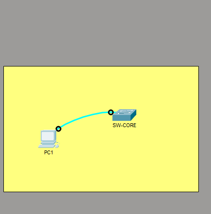
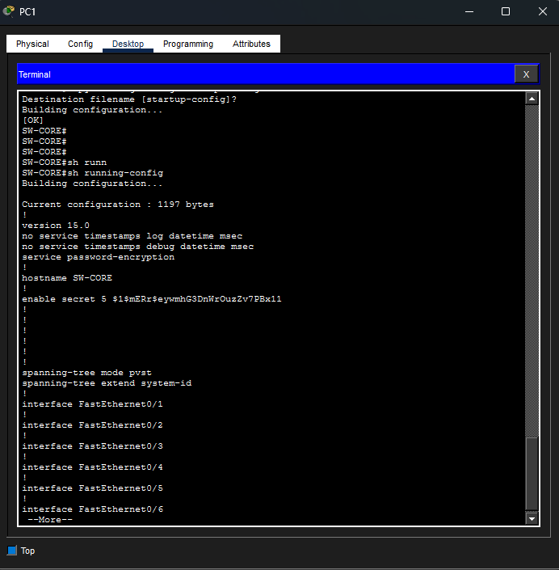
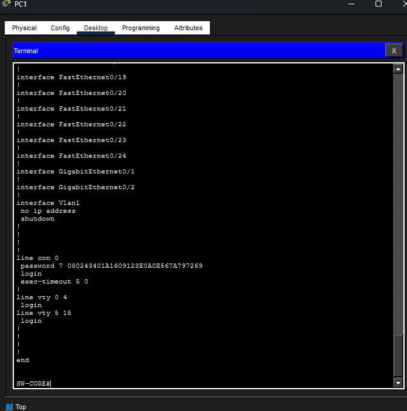
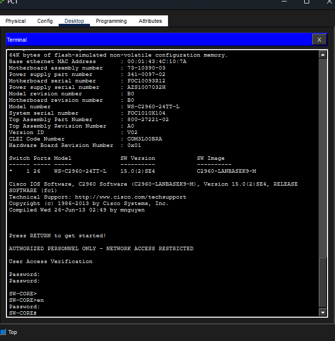

# Lab 03 — Secure Cisco Switch Administration

**Cisco CCNA 200-301 | Cisco Packet Tracer | Network Security Fundamentals**

## 1. Project Overview

This laboratory demonstrates the initial configuration and basic administrative security of a Cisco Catalyst 2960 switch using Cisco IOS.

The objective was to configure a new network device, secure local administrative access, implement console authentication, display a security warning banner, and verify that the configuration persists after a system reboot.

The lab was completed using a direct console connection between an administrator workstation and a Cisco switch.

## 2. Network Topology



### Devices Used

| Device | Model | Purpose |
|---|---|---|
| PC-ADMIN | Packet Tracer PC | Administrative workstation |
| SW-CORE | Cisco Catalyst 2960 | Managed network switch |
| Console Cable | Rollover | Local administrative access |

**Physical connection:** PC-ADMIN RS-232 → SW-CORE Console.

No IPv4 address was required because the switch was accessed through its console port rather than through an IP network.

## 3. Laboratory Objectives

- Establish local administrative access through a console cable.
- Navigate between Cisco IOS operating modes.
- Configure the device hostname.
- Protect Privileged EXEC mode using `enable secret`.
- Configure console password authentication.
- Enable password obfuscation.
- Configure a Message of the Day (MOTD) security banner.
- Implement a five-minute console inactivity timeout.
- Save the running configuration to NVRAM.
- Verify the configuration after restarting the switch.

## 4. Initial Cisco IOS Configuration

### 4.1 Accessing the Device

The administrator PC was connected to the switch using a rollover cable.

The terminal session used the default serial parameters:

| Parameter | Value |
|---|---|
| Baud rate | 9600 |
| Data bits | 8 |
| Parity | None |
| Stop bits | 1 |
| Flow control | None |

After opening the terminal, Cisco IOS provided access to User EXEC mode.

### 4.2 Configuring the Hostname

The device hostname was changed using:

```text
enable
configure terminal
hostname SW-CORE
```

The command prompt changed to `SW-CORE(config)#`, confirming the new hostname.

### 4.3 Protecting Privileged EXEC Mode

The `enable secret` command was used to protect privileged administrative access.

```text
enable secret <LAB_SECRET>
```

The Packet Tracer device stored the secret using a Type 5 hash.

This authentication is requested when moving from User EXEC mode (`>`) to Privileged EXEC mode (`#`).

### 4.4 Configuring Console Authentication

The console line was configured with traditional password authentication:

```text
line console 0
password <LAB_CONSOLE_PASSWORD>
login
```

The `password` command defines the console credential, while `login` enables password verification.

### 4.5 Configuring an Inactivity Timeout

To reduce the risk of unattended administrative sessions, a timeout was configured:

```text
line console 0
exec-timeout 5 0
```

This setting terminates an inactive EXEC session after five minutes.

### 4.6 Enabling Password Obfuscation

The following global configuration command was applied:

```text
service password-encryption
```

This causes supported plaintext passwords to be displayed in an obfuscated form in the configuration.

**Security consideration:** Cisco Type 7 passwords use reversible obfuscation and should not be considered secure encryption. Stronger authentication methods should be used in production environments.

### 4.7 Configuring the MOTD Security Banner

A warning message was configured:

```text
banner motd #AUTHORIZED PERSONNEL ONLY - NETWORK ACCESS RESTRICTED#
```

The banner is displayed during device access to indicate that administrative access is restricted.

## 5. Configuration Verification

The active configuration was inspected using:

```text
show running-config
```

### Running Configuration Evidence



The output was used to verify the configured device settings.

### Additional Configuration Verification



The Cisco IOS configuration was reviewed to identify administrative security settings and confirm that they were applied.

### Console Security and Timeout



The console configuration confirmed:

- Console password authentication.
- The `login` command.
- A five-minute inactivity timeout.
- Password obfuscation enabled through global configuration.

Sensitive password hashes and credentials should be redacted from public screenshots.

## 6. Authentication Testing

After configuring the console password and enabling `login`, the administrative session was closed and reopened.

Cisco IOS displayed the configured security banner and requested the console password.

Following successful console authentication, User EXEC mode became available.

The `enable` command required separate privileged authentication.

### Cisco IOS Access Levels

| Cisco IOS Prompt | Operating Mode |
|---|---|
| `SW-CORE>` | User EXEC |
| `SW-CORE#` | Privileged EXEC |
| `SW-CORE(config)#` | Global Configuration |
| `SW-CORE(config-line)#` | Line Configuration |

These modes provide different levels of access to operational and configuration commands.

## 7. Saving the Configuration

The running configuration was saved using:

```text
copy running-config startup-config
```

Cisco IOS returned `[OK]`, indicating that the save operation completed successfully.

### Running vs. Startup Configuration

| Configuration | Storage | Purpose |
|---|---|---|
| Running-config | RAM | Active device configuration |
| Startup-config | NVRAM | Configuration loaded during normal startup |

Saving the configuration is essential to prevent configuration changes from being lost during a reboot.

## 8. Reload and Persistence Verification

After saving the configuration, the switch was restarted using:

```text
reload
```

The switch successfully completed its startup process.

The following behavior was observed after the reboot:

- The configured MOTD banner appeared.
- Console password authentication was requested.
- The hostname remained `SW-CORE`.
- Privileged EXEC access continued to require authentication.
- The saved configuration remained operational.

This confirmed that the previously saved configuration was loaded successfully after the restart.

## 9. Troubleshooting and Technical Observations

### Issue: Console Authentication Requires Login

During the configuration process, I learned that defining a console password does not automatically activate traditional line-password authentication.

Both commands are required:

```text
line console 0
password <LAB_CONSOLE_PASSWORD>
login
```

### Issue: Cisco IOS Command Modes

Some configuration commands are only available in specific Cisco IOS modes.

Understanding the command hierarchy helped me correctly configure global settings, console authentication, and privileged access.

### Administrative Security Considerations

This exercise demonstrated basic local administrative protection.

However, console passwords and Type 7 obfuscation alone are not sufficient for secure enterprise device management.

More advanced management security mechanisms, including SSH and stronger authentication methods, will be explored in future laboratories.

## 10. Laboratory Results

| Verification | Result |
|---|---|
| Console connection established | Passed |
| Hostname configuration | Passed |
| Privileged EXEC authentication | Passed |
| Console authentication | Passed |
| Password obfuscation | Verified |
| MOTD security banner | Passed |
| Console inactivity timeout configuration | Verified |
| Running configuration inspection | Passed |
| Startup configuration saved | Passed |
| Configuration persistence after reboot | Passed |

## 11. Key Lessons Learned

Through this laboratory, I developed practical skills in:

1. Establishing a console connection to a Cisco switch.
2. Navigating Cisco IOS command modes.
3. Configuring a device hostname.
4. Implementing console and privileged access authentication.
5. Understanding password storage and obfuscation.
6. Configuring administrative warning banners.
7. Implementing inactivity timeouts.
8. Verifying Cisco IOS configurations.
9. Saving device configurations to NVRAM.
10. Confirming configuration persistence after a reboot.

## 12. Project Files and Evidence

| Resource | Description |
|---|---|
| [Packet Tracer Lab](Lab-03-Secure-Switch-Administration.pkt) | Complete Cisco Packet Tracer topology and device configuration |
| [Evidence Gallery](evidence/README.md) | Screenshots of the configuration and verification process |

All credentials used in this laboratory are fictional training credentials and must not be reused in production environments.

## 13. Conclusion

This laboratory demonstrates the initial administration and basic security configuration of a Cisco Catalyst switch.

The configuration process included local console access, authentication controls, a security warning banner, password obfuscation, inactivity timeout configuration, and verification of configuration persistence after a system restart.

Completing this exercise strengthened my understanding of Cisco IOS device management and the importance of validating administrative security configurations through practical testing.

---

**Tools:** Cisco Packet Tracer  
**Certification Track:** Cisco CCNA 200-301  
**Study Reference:** Jeremy's IT Lab — Cisco IOS CLI and Basic Device Configuration  
**Project Category:** Network Administration and Device Security
