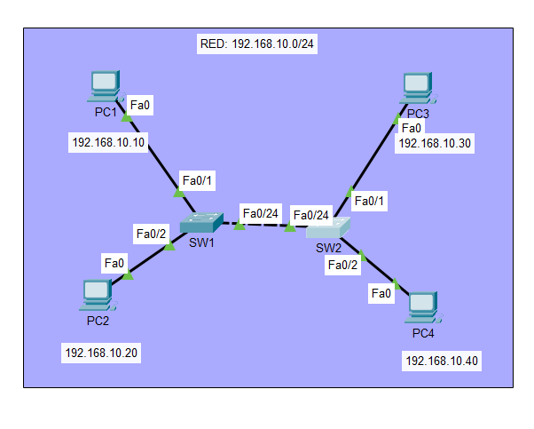

# Lab 04 — Ethernet Switching & MAC Address Learning

**Cisco CCNA 200-301 | Cisco Packet Tracer | Layer 2 Networking**

## 1. Project Overview

This laboratory explores Ethernet switching, dynamic MAC address learning, ARP resolution, broadcast flooding, unicast forwarding, and ICMP connectivity within a Local Area Network (LAN).

The network was built using two Cisco Catalyst 2960 switches and four end devices connected to the same IPv4 subnet.

Using Cisco Packet Tracer's Simulation Mode and Cisco IOS commands, I analyzed how Ethernet frames travel across interconnected switches, how MAC address tables are populated, and how the network behaves when a switch access port is administratively disabled.

## 2. Network Topology



The topology consists of two Layer 2 switches interconnected through FastEthernet0/24.

Each switch provides connectivity to two PCs.

### Devices

| Device | Model | Purpose |
|---|---|---|
| SW1 | Cisco Catalyst 2960 | Layer 2 switching |
| SW2 | Cisco Catalyst 2960 | Layer 2 switching |
| PC1 | Packet Tracer PC | Source host |
| PC2 | Packet Tracer PC | Local host |
| PC3 | Packet Tracer PC | Destination host |
| PC4 | Packet Tracer PC | Additional host for connectivity testing |

### Physical Connections

| Source | Interface | Destination | Interface |
|---|---|---|---|
| PC1 | FastEthernet0 | SW1 | Fa0/1 |
| PC2 | FastEthernet0 | SW1 | Fa0/2 |
| SW1 | Fa0/24 | SW2 | Fa0/24 |
| PC3 | FastEthernet0 | SW2 | Fa0/1 |
| PC4 | FastEthernet0 | SW2 | Fa0/2 |

PC-to-switch links use copper straight-through cables.

The switch-to-switch link uses a copper cross-over cable.

## 3. IPv4 Addressing

All devices belong to the same IPv4 subnet.

**Network:** `192.168.10.0/24`

**Subnet mask:** `255.255.255.0`

| Device | IPv4 Address | Subnet Mask |
|---|---|---|
| PC1 | 192.168.10.10 | 255.255.255.0 |
| PC2 | 192.168.10.20 | 255.255.255.0 |
| PC3 | 192.168.10.30 | 255.255.255.0 |
| PC4 | 192.168.10.40 | 255.255.255.0 |

No default gateway was required because all hosts communicate within the same subnet.

## 4. Laboratory Objectives

- Build a functional Ethernet LAN using two Layer 2 switches.
- Configure static IPv4 addressing on four PCs.
- Understand dynamic MAC address learning.
- Inspect Cisco switch MAC address tables.
- Understand Ethernet broadcast flooding.
- Analyze ARP Request and ARP Reply messages.
- Observe ICMP Echo Request and Echo Reply communication.
- Differentiate broadcast, unknown unicast, and known unicast traffic.
- Verify how switches forward frames through specific interfaces.
- Analyze the effect of disabling an unrelated host access port.

## 5. Initial Switch Configuration

The Cisco IOS CLI was used to configure device hostnames.

### SW1

```text
enable
configure terminal
hostname SW1
end
```

### SW2

```text
enable
configure terminal
hostname SW2
end
```

The following commands were used to verify operational interfaces and learned MAC addresses:

```text
show interfaces status
show mac address-table
show mac address-table dynamic
```

## 6. Dynamic MAC Address Learning

An Ethernet switch learns source MAC addresses from incoming frames.

When SW1 receives a frame from PC1 through FastEthernet0/1, it associates PC1's source MAC address with that interface and VLAN.

If a frame arrives with a known unicast destination MAC address, the switch forwards it through the associated interface.

If the destination MAC address is an unknown unicast address, the switch floods the frame through the other eligible ports in the same VLAN.

Broadcast frames are also forwarded through the other eligible ports in the broadcast domain.

### Clearing Dynamic MAC Entries

To observe MAC address learning again, I executed:

```text
clear mac address-table dynamic
```

The switch can immediately relearn MAC addresses when new frames arrive.

## 7. ARP Resolution

PC1 initiated communication with PC3 using:

```text
ping 192.168.10.30
```

Before transmitting the ICMP packet in an Ethernet unicast frame, PC1 needed to determine the destination MAC address.

When the required entry was not present in its ARP cache, PC1 generated an ARP Request.

### ARP Request

The request was sent as an Ethernet broadcast:

```text
Source IPv4:       192.168.10.10
Target IPv4:       192.168.10.30
Destination MAC:   FFFF.FFFF.FFFF
```

SW1 forwarded the broadcast through the other active ports in the same VLAN.

The request reached SW2, which forwarded it toward its connected hosts.

### ARP Reply

PC3 recognized its own IPv4 address in the ARP Request and generated an ARP Reply.

The reply provided its MAC address to PC1.

The switches learned source MAC addresses as they received the corresponding Ethernet frames.

Once PC1 learned PC3's MAC address, it could encapsulate ICMP packets inside unicast Ethernet frames addressed to PC3.

## 8. ARP Cache Verification

After communication was established, I executed the following command on PC1:

```text
arp -a
```

The output confirmed the IPv4-to-MAC association:

| IPv4 Address | Physical Address | Type |
|---|---|---|
| 192.168.10.30 | 0060.5CE4.DC2A | Dynamic |

This confirms that PC1 successfully resolved PC3's MAC address.

**Technical distinction:** The ARP cache associates IPv4 addresses with MAC addresses. The switch MAC address table associates MAC addresses with switch ports and VLANs.

## 9. ICMP Connectivity Verification

After ARP resolution, PC1 successfully sent ICMP Echo Requests to PC3.

### Command

```text
ping 192.168.10.30
```

### Verified Result

```text
Packets: Sent = 4
Packets: Received = 4
Packet loss: 0%
```

The successful test confirmed end-to-end communication across SW1 and SW2.

## 10. MAC Address Table Analysis

After the communication tests, I examined the dynamic MAC address tables on both switches.

### SW1 — Observed MAC Entries

| MAC Address | Interface | Type |
|---|---|---|
| 0001.9717.75C6 | Fa0/1 | Dynamic |
| 0001.9625.9A18 | Fa0/24 | Dynamic |
| 0060.5CE4.DC2A | Fa0/24 | Dynamic |

### SW2 — Observed MAC Entries

| MAC Address | Interface | Type |
|---|---|---|
| 0001.9717.75C6 | Fa0/24 | Dynamic |
| 000C.CFE6.8718 | Fa0/24 | Dynamic |
| 0060.5CE4.DC2A | Fa0/1 | Dynamic |

These tables demonstrate that the same MAC address may be learned through different interfaces on different switches.

For example, PC1's MAC address was learned on Fa0/1 by SW1 and through the inter-switch connection Fa0/24 by SW2.

The MAC address associated with PC3 was learned on Fa0/1 by SW2 and through Fa0/24 by SW1.

This behavior enables Ethernet switches to forward known unicast traffic through the appropriate ports.

## 11. Troubleshooting — PC4 Port Isolation

To evaluate how an individual access port affects connectivity, I intentionally disabled the interface connecting SW2 to PC4.

### Failure Simulation

```text
enable
configure terminal
interface fastEthernet 0/2
shutdown
```

Cisco IOS reported that the interface was administratively down.

### Connectivity Test

With PC4 disconnected through the disabled switch port, I repeated:

```text
ping 192.168.10.30
```

**Observed result:**

- Packets sent: 4
- Packets received: 4
- Packet loss: 0%

PC1 and PC3 remained connected because the active forwarding path between the two devices did not depend on PC4's access port.

The test demonstrated that disabling an unrelated host access port does not necessarily interrupt communication between other devices in the LAN.

To restore the interface:

```text
configure terminal
interface fastEthernet 0/2
no shutdown
```

## 12. Troubleshooting and Technical Observations

### Broadcast vs. Unknown Unicast

An ARP Request is commonly transmitted using the Ethernet broadcast destination address.

Unknown unicast flooding is different: it occurs when a switch receives a frame addressed to a unicast MAC address that is not present in its forwarding table.

### Source MAC Learning

Switches learn from the source MAC address of incoming Ethernet frames.

Destination MAC addresses are used to make forwarding decisions, not to create new source-learning entries.

### Layer 2 Switching vs. Layer 3 Routing

The Catalyst 2960 switches in this lab forwarded Ethernet frames using MAC address tables.

No router was needed because all hosts belonged to the same IPv4 subnet.

### Dynamic MAC Address Aging

Learned MAC entries can disappear after their aging timers expire, or when entries are cleared or invalidated.

Switches can relearn them when subsequent Ethernet traffic arrives.

## 13. Verification Summary

| Test | Result |
|---|---|
| Network topology | Passed |
| IPv4 addressing | Passed |
| Physical connectivity | Passed |
| Dynamic MAC learning | Verified |
| ARP Request broadcast | Verified |
| ARP Reply | Verified |
| ICMP communication | Passed |
| ARP cache verification | Passed |
| MAC address table inspection | Passed |
| PC4 access-port isolation | Passed |
| PC1–PC3 communication during isolation | Passed |

## 14. Key Lessons Learned

Through this laboratory, I developed practical knowledge of:

1. Ethernet switching and MAC address learning.
2. Source MAC address learning and Layer 2 forwarding decisions.
3. Ethernet broadcast flooding.
4. ARP Request and ARP Reply operations.
5. The difference between ARP caches and switch MAC address tables.
6. ICMP connectivity across multiple switches.
7. Using Cisco Packet Tracer Simulation Mode to inspect Ethernet frames.
8. Interpreting dynamic MAC address entries.
9. Understanding the impact of administratively disabling a switch interface.
10. Applying a structured troubleshooting approach to a LAN.

## 15. Project Files

| Resource | Description |
|---|---|
| [Packet Tracer Lab](Lab-04-Ethernet-Switching.pkt) | Complete network topology and configurations |
| [Evidence Gallery](evidence/README.md) | Screenshots documenting packet forwarding, ARP, ICMP, MAC tables, and troubleshooting |

## 16. Conclusion

This laboratory demonstrates how Ethernet switches forward frames within a Local Area Network using dynamically learned MAC address tables.

By observing ARP resolution and ICMP communication in Cisco Packet Tracer, I gained a clearer understanding of the relationship between IPv4 addressing, MAC addresses, broadcast domains, and Layer 2 switching.

The troubleshooting test also demonstrated that disabling an unrelated switch access port does not necessarily disrupt communication between other hosts.

The laboratory strengthened my understanding of fundamental Layer 2 operations and prepared me for more advanced CCNA topics involving switching, routing, and network troubleshooting.

---

**Tools:** Cisco Packet Tracer  
**Certification Track:** Cisco CCNA 200-301  
**Study Reference:** Jeremy's IT Lab — Ethernet LAN Switching  
**Project Category:** Layer 2 Networking and Troubleshooting
