# Lab 04 — Ethernet Switching & MAC Learning Evidence

**Cisco CCNA 200-301 | Cisco Packet Tracer**

## Overview

This folder contains 16 screenshots collected during Lab 04.

The screenshots document the network topology, Cisco IOS MAC address tables, ARP resolution, ICMP traffic, Ethernet frame forwarding, and a controlled switch interface shutdown.

The evidence was collected using Cisco Packet Tracer and its Simulation Mode.

## Network Topology and Initial Configuration

### Evidence 01

### Evidence 02

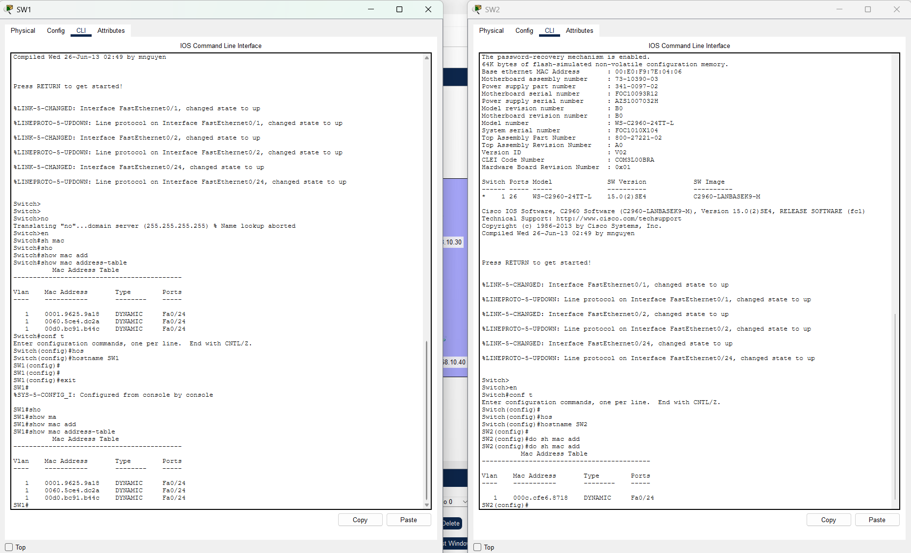

### Evidence 03

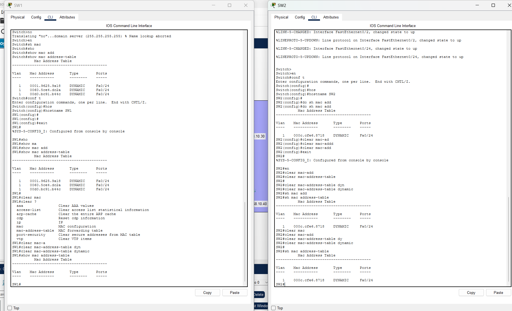

### Evidence 04

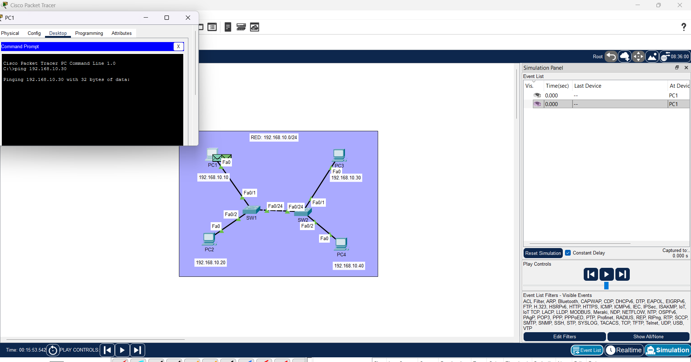

## Switching and Protocol Analysis

### Evidence 05

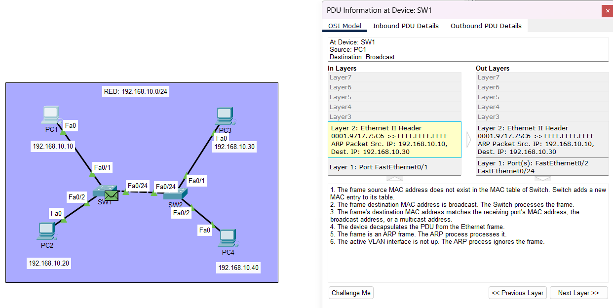

### Evidence 06

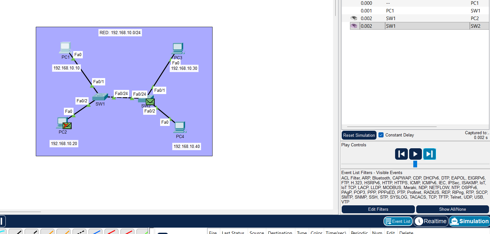

### Evidence 07

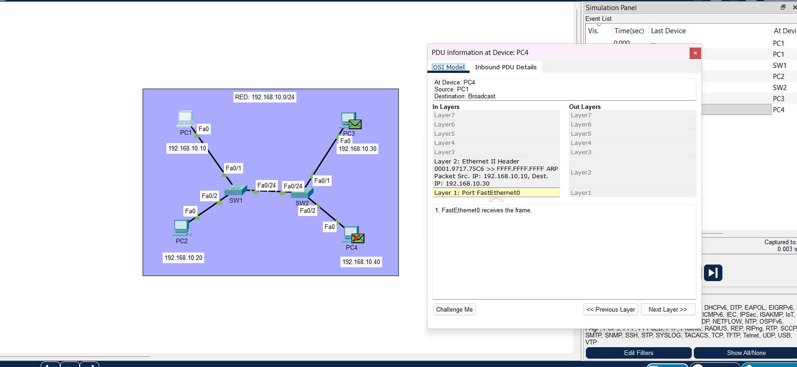

### Evidence 08

### Evidence 09

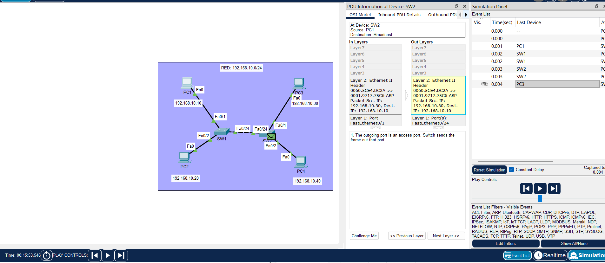

### Evidence 10

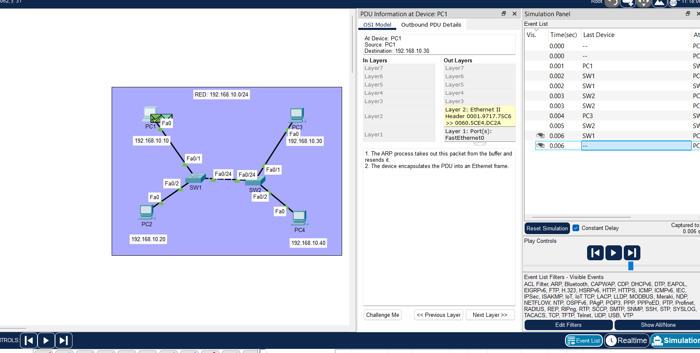

### Evidence 11

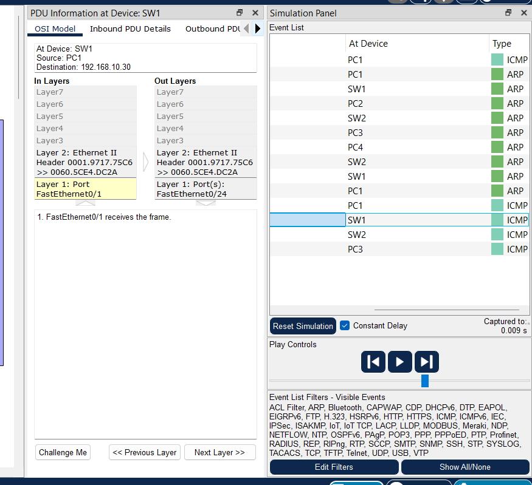

### Evidence 12

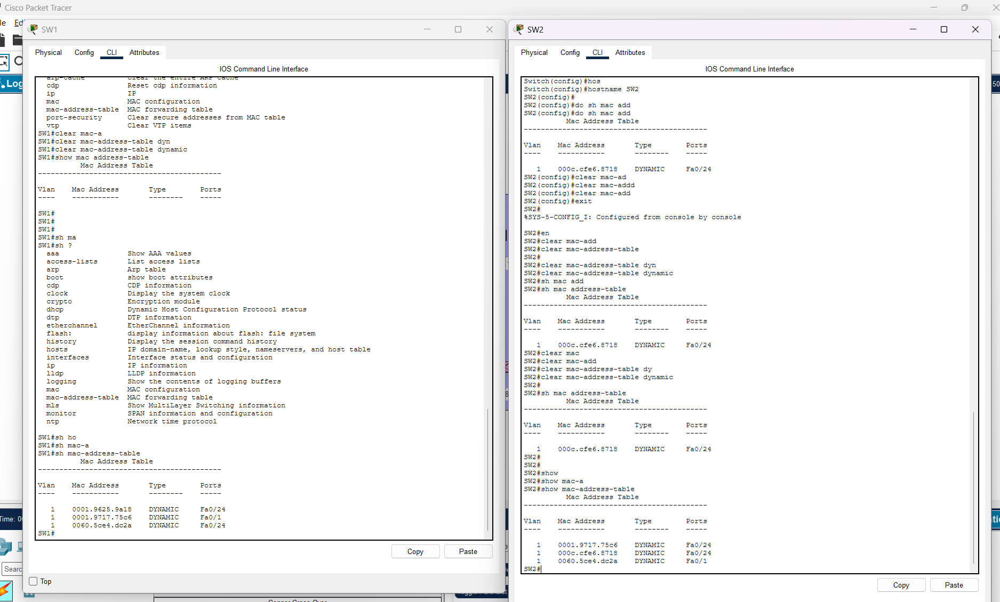

## Connectivity Verification and Troubleshooting

### Evidence 13

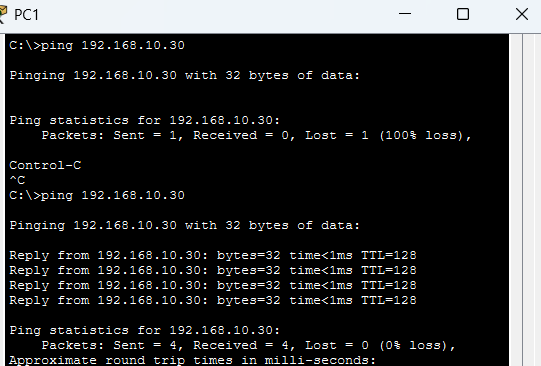

### Evidence 14

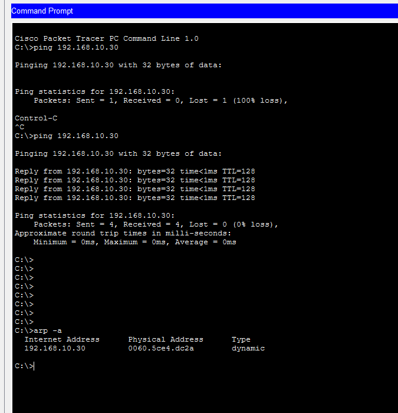

### Evidence 15

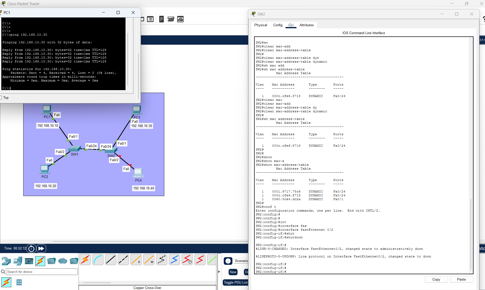

### Evidence 16

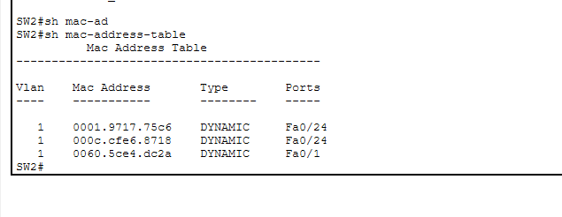

---

## Verified Laboratory Results

| Verification | Result |
|---|---|
| Four-host Ethernet LAN | Operational |
| SW1 and SW2 interconnection | Operational |
| IPv4 addressing | Verified |
| Dynamic MAC learning | Verified |
| ARP Request and Reply | Observed |
| ICMP connectivity PC1 to PC3 | 0% packet loss in final test |
| PC1 ARP cache | PC3 IP-to-MAC association verified |
| SW2 Fa0/2 administrative shutdown | Verified |
| PC1 to PC3 communication during PC4 isolation | Successful |

## Technical Summary

The screenshots demonstrate the forwarding behavior of Cisco Layer 2 switches, including source MAC learning and Ethernet frame forwarding.

ARP was used to resolve the destination host's IPv4 address to a MAC address before normal unicast ICMP communication.

The final tests confirmed successful connectivity between PC1 and PC3, including during the administrative shutdown of PC4's access port.

These observations were used to validate the network's behavior and understand Layer 2 troubleshooting.

---

[Return to Lab 04 Documentation](../README.md)

**Tools:** Cisco Packet Tracer  
**Certification:** Cisco CCNA 200-301  
**Reference:** Jeremy's IT Lab — Ethernet LAN Switching
