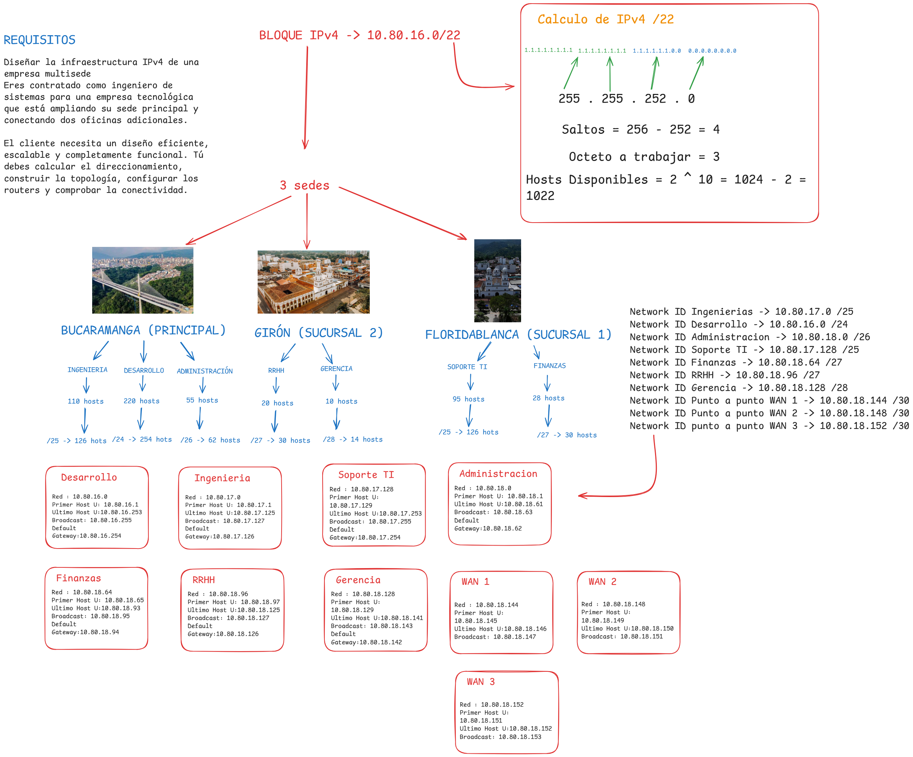

# Lab 07 — Enterprise VLSM, VLANs & Static Routing

## Overview

This lab demonstrates the planning, implementation, and validation of a multi-site enterprise network using Cisco Packet Tracer.

The network connects three locations in Santander, Colombia:

- **Bucaramanga:** Headquarters
- **Girón:** Branch Office 2
- **Floridablanca:** Branch Office 1

The implementation integrates variable-length subnet masking (VLSM), VLAN segmentation, IEEE 802.1Q trunking, Router-on-a-Stick, point-to-point WAN links, and static routing.

## Network Design



*Figure 1. Enterprise network topology and addressing design created for this laboratory.*

## Learning Objectives

- Design and calculate IPv4 subnets using VLSM.
- Allocate addresses from the `10.80.16.0/22` network block.
- Configure seven departmental VLANs across three locations.
- Implement access ports and IEEE 802.1Q trunk links.
- Configure inter-VLAN routing using Router-on-a-Stick.
- Establish three point-to-point WAN connections.
- Configure bidirectional static routes between remote LANs.
- Troubleshoot connectivity using Cisco IOS verification commands.
- Validate end-to-end connectivity with ICMP.

## VLAN and IP Addressing Plan

| Location | Department | VLAN | Subnet | Default Gateway |
|---|---|---|---|---|
| Bucaramanga | Engineering | 10 | 10.80.17.0/25 | 10.80.17.126 |
| Bucaramanga | Administration | 20 | 10.80.18.0/26 | 10.80.18.62 |
| Bucaramanga | Development | 30 | 10.80.16.0/24 | 10.80.16.254 |
| Girón | Human Resources | 40 | 10.80.18.96/27 | 10.80.18.126 |
| Girón | Management | 50 | 10.80.18.128/28 | 10.80.18.142 |
| Floridablanca | IT Support | 60 | 10.80.17.128/25 | 10.80.17.254 |
| Floridablanca | Finance | 70 | 10.80.18.64/27 | 10.80.18.94 |

## WAN Addressing

| WAN Link | Network | Router Interfaces |
|---|---|---|
| R1–R2 | 10.80.18.144/30 | R1: 10.80.18.145 — R2: 10.80.18.146 |
| R2–R3 | 10.80.18.148/30 | R2: 10.80.18.149 — R3: 10.80.18.150 |
| R1–R3 | 10.80.18.152/30 | R1: 10.80.18.153 — R3: 10.80.18.154 |

## Technical Implementation

### VLAN Segmentation

Departmental devices were assigned to access ports belonging to their respective VLANs. This established separate Layer 2 broadcast domains.

### IEEE 802.1Q Trunking

Trunk ports were configured between the switches and their respective routers to transport traffic from multiple departmental VLANs over a single Ethernet connection.

### Router-on-a-Stick

Router subinterfaces were configured with `encapsulation dot1Q` and the appropriate IPv4 default gateway addresses, enabling inter-VLAN routing at each site.

### Static Routing

Specific static routes were installed on R1, R2, and R3 to provide connectivity between all seven departmental LANs across the three-site WAN topology.

## Verification and Testing

The following Cisco IOS commands were used:

```text
show vlan brief
show interfaces trunk
show ip interface brief
show ip route
ping
```

Validation included:

- Local default gateway connectivity.
- Inter-VLAN communication within each site.
- Point-to-point WAN interface verification.
- Remote subnet reachability using static routing.
- Cross-site ICMP communication and return-path validation.

The recorded ICMP tests demonstrated successful communication between remote departments. Some initial requests timed out before subsequent replies succeeded.

## Troubleshooting

The laboratory included diagnosing and resolving several configuration challenges:

- Insufficient physical router interfaces for multiple departmental subnets.
- VLAN tagging requirements for Ethernet router subinterfaces.
- Trunk interfaces that were administratively configured but not yet operational.
- Static routing and return-path requirements.
- Differences between locally connected, static, and default routes.

## Evidence and Deliverables

The complete technical report contains the implementation details, screenshots, verification outputs, and test results.

**Technical Report:** [View Lab 07 PDF](Lab_07_CCNA_Enterprise_VSLM.pdf)

**Packet Tracer Project:** `Lab07-Enterprise-VLSM.pkt`

## Key Takeaways

This laboratory demonstrates how IPv4 planning, Layer 2 segmentation, inter-VLAN routing, and Layer 3 routing work together to provide connectivity across a multi-site enterprise network.

The final topology uses seven departmental VLANs, three Cisco routers, three point-to-point WAN networks, and specific static routes.

---

**Platform:** Cisco Packet Tracer  
**Certification Track:** Cisco CCNA 200-301  
**Category:** Networking | VLSM | VLANs | 802.1Q | Inter-VLAN Routing | Static Routing
